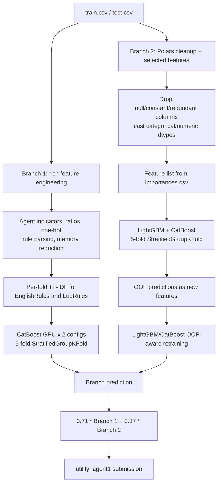

# 🏆 UM - Game-Playing Strength of MCTS Variants — Bronze Medal, Rank 119/1,608

<p align="center">
  <a href="https://img.shields.io/badge/Kaggle-Competition-20BEFF?logo=kaggle&logoColor=white&style=flat-square"></a>
  <a href="https://img.shields.io/badge/Award-Bronze%20%7C%20119%2F1608-CD7F32?style=flat-square"></a>
  <a href="https://img.shields.io/badge/Metric-RMSE-555555?style=flat-square"></a>
  <a href="https://img.shields.io/badge/Python-3.10-3776AB?logo=python&logoColor=white&style=flat-square"></a>
  <a href="https://img.shields.io/badge/Stack-CatBoost%20%7C%20LightGBM-2E8B57?style=flat-square"></a>
  <a href="https://img.shields.io/badge/License-Not%20specified-lightgrey?style=flat-square"></a>
</p>

<p align="center"><b>English</b> | <a href="./README_zh.md">简体中文</a></p>

<div align="center">
  <a href="https://storage.googleapis.com/kaggle-competition-certificates/22972956/0fdb024a3bec2955d8d1962bd629da5f.png">
    
  </a>
  <p><em>🏅 Official Kaggle Competition Award Certificate — Bronze Medal, 119th of 1,608 teams</em></p>
</div>

## 1. Executive Summary

This repository preserves the Kaggle submission notebook for **UM - Game-Playing Strength of MCTS Variants**. The solution is a two-branch tabular regression system for `utility_agent1`: a feature-rich GPU CatBoost branch and an OOF-aware CPU LightGBM/CatBoost branch. Both branches use `StratifiedGroupKFold` grouped by `GameRulesetName`, and their predictions are combined by the notebook's final weighted blend.

The tracked Notebook keeps its source cells and runtime metadata; generated cell outputs are intentionally stripped to keep the repository reviewable and avoid storing transient logs or plots.

### Problem and Core Challenges

- **Task:** predict the continuous target `utility_agent1` from game-rule, board, agent, performance, and outcome descriptors.
- **Metric:** the notebook evaluates folds with RMSE and reports the same target-space metric in its local diagnostics.
- **Generalization risk:** rows from the same `GameRulesetName` must not be mixed carelessly across validation folds.
- **Feature heterogeneity:** the data combines numeric game statistics, categorical agent configurations, long rule strings, sparse one-hot columns, and high-cardinality metadata.

### Winning Approach Overview

Branch 1 constructs interaction and ratio features, parses agent configurations, cleans `EnglishRules`/`LudRules`, and fits two GPU CatBoost regressors across five stratified group folds. Branch 2 removes null/constant/redundant columns, applies a precomputed feature-selection list, and trains five-fold LightGBM and CatBoost models. It then adds branch-level OOF predictions as features and retrains OOF-aware models. The final prediction is `0.71 * branch_1 + 0.37 * branch_2`.

## 2. Solution Architecture and Pipeline



### Pipeline Stages

1. **Input and runtime mode:** the notebook reads Kaggle competition CSVs with Polars/Pandas. `KAGGLE_IS_COMPETITION_RERUN` switches off the short local settings.
2. **Branch 1 preprocessing:** derives agent-position indicators, board-area and efficiency ratios, clips outliers, decomposes agent strings, adds selected one-hot features, parses `LudRules`, drops unstable/highly redundant columns, and downcasts memory.
3. **Branch 1 text features:** cleans rule text, adds text length, and fits a separate `TfidfVectorizer(max_features=500, ngram_range=(2, 3))` inside each model/fold.
4. **Branch 2 preprocessing:** removes identifiers, all-null columns, constant columns, explicit redundant text/count columns, and features listed in `importances.csv`; categorical columns are preserved as category/string types.
5. **Training and inference:** both branches use grouped stratification on `round(utility_agent1 * 15)` and `GameRulesetName`, then average model predictions before the final blend.

## 3. Key Technical Insights

### 3.1 Validation Strategy

The implemented CV strategy is `StratifiedGroupKFold` with `GameRulesetName` as the group and `round(y * 15)` as the stratification proxy:

- **Branch 1:** `Preprocessor(num_folds=5, ...)` creates five folds; the constructor's default of ten is overridden by the actual call.
- **Branch 2:** `CFG.n_splits = 5` creates five folds.
- **OOF integrity:** branch 2 stores fold OOF predictions, appends them to the training table, and uses them to train the second-stage `LightGBM w/ OOF` and `CatBoost w/ OOF` models.
- `GroupKFold` is imported but is not the splitter used by the final code path.

### 3.2 Data Preprocessing and Feature Engineering

**Branch 1 (`model_1.Preprocessor.FE`):**

- creates signed indicators for enumerated MCTS agent configurations;
- adds area, playout/move, efficiency, duration, complexity, timeout, outcome, and action-ratio interactions;
- clips `PlayoutsPerSecond` to `[0, 25,000]` and `MovesPerSecond` to `[0, 1,000,000]`;
- splits `agent1` and `agent2` into `selection`, `exploration_const`, `playout`, and `score_bounds` components;
- one-hot encodes selected low-cardinality numeric and agent fields;
- removes the game-name prefix from `LudRules`, extracts player/rule information, and drops a large explicit list of unstable or redundant columns;
- applies memory reduction to numeric columns;
- cleans `EnglishRules` and `LudRules`, adds text lengths, and creates fold-local TF-IDF features.

**Branch 2 (`model_2.FE`):**

- reads data in Polars with `batch_size=65536`;
- drops `Id`, raw rule text, training-only win/draw/loss counts, all-null columns, and columns with one unique value;
- casts `GameRulesetName`, `agent1`, and `agent2` to string and numeric columns to `Int16` or `Float32` where possible;
- applies `/kaggle/input/mcts-gbdt-select-200-features/importances.csv` as a drop-feature manifest.

### 3.3 Model Design and Training Configuration

| Branch | Model | Key parameters in the full submission mode |
| --- | --- | --- |
| 1 | CatBoost GPU `cat1` | 3,096 iterations, `learning_rate=0.08`, `depth=12`, `l2_leaf_reg=1.25`, `min_data_in_leaf=24`, `bagging_temperature=0.50`, `random_strength=0.25` |
| 1 | CatBoost GPU `cat2` | Same core settings, `bagging_temperature=0.60`, `random_strength=0.20`, `max_bin=2048` |
| 2 | LightGBM CPU | 20,000 iterations, `learning_rate=0.07`, `num_leaves=64`, `max_depth=24`, `extra_trees=True`, `reg_alpha=0.1`, `reg_lambda=0.8`, early stop 500 |
| 2 | CatBoost CPU | 20,000 trees, `learning_rate=0.03`, `depth=8`, `reg_lambda=0.8`, early stop 500 |

The notebook uses RMSE evaluation and early stopping. It does not define a custom loss, neural-network head, AMP, EMA, pseudo-labeling, or differentiable stacking layer.

### 3.4 Ensembling and Post-processing

- Branch 1 averages predictions from two CatBoost configurations across five folds.
- Branch 1 clips predictions after scaling by `1.1` to `[-0.985, 0.985]`.
- Branch 2 first creates base LightGBM/CatBoost OOF predictions, appends them as `lgb_oof_preds` and `ctb_oof_preds`, and retrains OOF-aware models.
- Branch 2 inference averages fold predictions and applies raw branch weights `0.80` for LightGBM and `0.30` for CatBoost.
- The final submission uses the exact code coefficients `0.71` and `0.37`; they are intentionally documented as raw coefficients and are not renormalized in the notebook.

### 3.5 What Did Not Work / Open Ablations

- `[TODO]` Compare grouped versus ungrouped CV with a leakage audit.
- `[TODO]` Measure the contribution of rule-text TF-IDF independently from structured features.
- `[TODO]` Record branch-level RMSE and final-blend RMSE in one experiment ledger.
- `[TODO]` Test normalized versus raw final blend coefficients.

## 4. Validation and Ablation Results

The archived evidence records a team result of **0.43045 private score and rank 119/1,608**. The Notebook's printed `0.43169` score is a separate local/notebook diagnostic and must not be conflated with the final team leaderboard record.

| Stage / Experiment | Key Changes | Local CV | Public LB | Private LB |
| :--- | :--- | :---: | :---: | :---: |
| Baseline | Raw tabular model with grouped RMSE validation | `[TODO]` | `[TODO]` | `[TODO]` |
| Branch 1 | Rich structural features + fold-local TF-IDF + CatBoost GPU | `[TODO]` | `[TODO]` | `[TODO]` |
| Branch 2 | Selected features + LightGBM/CatBoost OOF-aware retraining | `[TODO]` | `[TODO]` | `[TODO]` |
| Final submission | `0.71 * Branch 1 + 0.37 * Branch 2` | `[TODO]` | `[TODO]` | `0.43045 (archived team record)` |

## 5. Repository Structure

```text
.
├── assets/
│   └── certificate.png                         # README Hero certificate image
├── evidence/
│   ├── certificate_goldmoreandmore.json        # Current API certificate response
│   ├── certificate_goldmoreandmore.metadata.json
│   ├── competition.json                        # Competition metadata
│   ├── goldmoreandmore-official-certificate.png
│   ├── goldmoreandmore-official-certificate-2026-10-14-YU-JIAQI.png
│   │                                             # Historical certificate snapshot
│   ├── goldmoreandmore-official-certificate-2026-10-27-Jiang-Huajian.png
│   │                                             # Current certificate snapshot
│   ├── links.md                                # Official Kaggle links
│   └── team_119.json                            # Rank-119 team record
├── submission/
│   └── mcts-oof-predfe-pubnb-blending-lb-4xx-v4.ipynb
│                                                  # Downloaded Kaggle Notebook
├── README.md                                    # English technical documentation
└── README_zh.md                                 # Simplified Chinese technical documentation
```

## 6. Environment and Reproducibility

### 6.1 Hardware and Runtime

- Notebook metadata declares a GPU runtime and Python 3.10.14.
- Branch 1 requests CatBoost GPU; branch 2 explicitly uses CPU LightGBM/CatBoost.
- Local smoke mode uses `APP.small_iterations=True` and `APP.short_dataset=True`.
- When `KAGGLE_IS_COMPETITION_RERUN` is set, the code switches to full iterations and the full dataset.
- `[TODO: record exact GPU model, VRAM, wall-clock time, and full-run memory peak]`.

### 6.2 Installation

No standalone `requirements.txt` is included. The Notebook imports:

```text
polars pandas numpy scikit-learn lightgbm catboost xgboost dill
matplotlib plotly kaggle_evaluation
```

The canonical environment is the Kaggle Notebook runtime with the competition input and the auxiliary dataset used by branch 2:

```text
/kaggle/input/um-game-playing-strength-of-mcts-variants/train.csv
/kaggle/input/um-game-playing-strength-of-mcts-variants/test.csv
/kaggle/input/um-game-playing-strength-of-mcts-variants/sample_submission.csv
/kaggle/input/mcts-gbdt-select-200-features/importances.csv
```

### 6.3 Training and Inference Entry Points

The archive is a single Notebook, not a package with shell entry points. The actual execution path is:

```python
# Local smoke mode defaults to True; full Kaggle reruns set these to False.
APP.small_iterations = False
APP.short_dataset = False

# Branch 1: model_1.predict() trains once, then averages its saved fold models.
model_1.preprocessor.train_model()

# Branch 2: trains base LightGBM/CatBoost, adds OOF features,
# then trains the OOF-aware LightGBM/CatBoost models.
model_2.train_model()

# Final prediction path used by the notebook.
result = predict(test, submission)
```

For official execution, the notebook registers `kaggle_evaluation.mcts_inference_server.MCTSInferenceServer(predict)` and uses `serve()` during a competition rerun or `run_local_gateway()` otherwise.

### 6.4 Reproducibility Boundaries

The notebook depends on Kaggle-mounted CSVs, the auxiliary feature-selection file, GPU CatBoost support for branch 1, and the official MCTS inference gateway. The repository intentionally excludes generated `.model`, `.npy`, and runtime output files.

## Official Links

- [Competition](https://www.kaggle.com/competitions/um-game-playing-strength-of-mcts-variants)
- [Kaggle Notebook, script version 208056582](https://www.kaggle.com/code/goldmoreandmore/mcts-oof-predfe-pubnb-blending-lb-4xx?scriptVersionId=208056582)
- [Official certificate page](https://www.kaggle.com/certification/competitions/goldmoreandmore/um-game-playing-strength-of-mcts-variants)
- [Official certificate image](https://storage.googleapis.com/kaggle-competition-certificates/22972956/0fdb024a3bec2955d8d1962bd629da5f.png)
