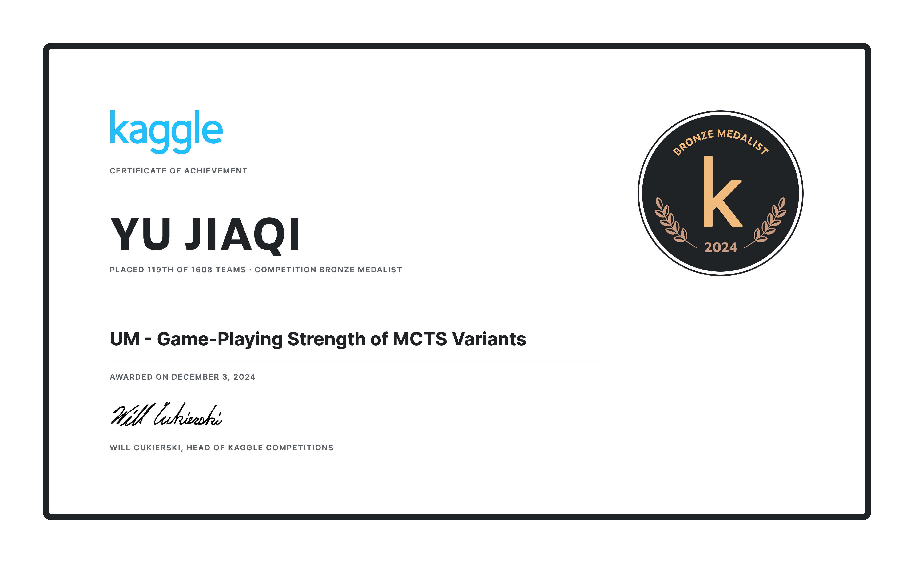

# UM - Game-Playing Strength of MCTS Variants

<p align="center">
  <a href="https://storage.googleapis.com/kaggle-competition-certificates/22972956/0fdb024a3bec2955d8d1962bd629da5f.png">
    
  </a>
</p>

<p align="center">
  <strong>Team Bronze Medal</strong> · 119th of 1,608 teams · Awarded December 3, 2024
</p>

This repository archives a downloaded Kaggle notebook and the official
team-related evidence for **UM - Game-Playing Strength of MCTS Variants**.
The certificate cover above opens the official Kaggle-hosted certificate for
the source account. Its Kaggle certificate page is linked below.

## Result Summary

| Field | Record |
| --- | --- |
| Competition | UM - Game-Playing Strength of MCTS Variants |
| Team result | Bronze Medal |
| Final private rank | 119 / 1,608 teams |
| Final private score | `0.43045` |
| Notebook source account | `goldmoreandmore` |
| Script version | `208056582` |
| Notebook score | `0.43169` |

## Submission

- Notebook: [`mcts-oof-predfe-pubnb-blending-lb-4xx-v4.ipynb`](submission/mcts-oof-predfe-pubnb-blending-lb-4xx-v4.ipynb)
- Kaggle notebook: [Open the original Kaggle notebook](https://www.kaggle.com/code/goldmoreandmore/mcts-oof-predfe-pubnb-blending-lb-4xx?scriptVersionId=208056582)
- Competition page: [Open the official competition page](https://www.kaggle.com/competitions/um-game-playing-strength-of-mcts-variants)
- Certificate page: [Open the official certificate page](https://www.kaggle.com/certification/competitions/goldmoreandmore/um-game-playing-strength-of-mcts-variants)

## Evidence Boundary

The archived Kaggle certificate response and official certificate image name
`YU JIAQI`, and the official rank-119 team record lists `goldmoreandmore` as a
team member. They do not establish a personal Jiang Huajian certificate.
This repository therefore labels the result as **team-related evidence** and
does not present it as an individually verified Jiang Huajian award.

The notebook score (`0.43169`) is different from the team's final private
leaderboard score (`0.43045`). This archive does not claim that script version
`208056582` is the exact submission that produced the final team rank.

## Repository Layout

```text
.
├── evidence/
│   ├── certificate_goldmoreandmore.json
│   ├── certificate_goldmoreandmore.metadata.json
│   ├── competition.json
│   ├── goldmoreandmore-official-certificate.png
│   ├── links.md
│   └── team_119.json
├── submission/
│   └── mcts-oof-predfe-pubnb-blending-lb-4xx-v4.ipynb
└── README.md
```

## Scope and Reproducibility

The notebook is an unmodified Kaggle download. Kaggle datasets, model
weights, credentials, private runtime outputs, and external services are not
included. Reproduction may require the original competition data, notebook
dependencies, and Kaggle runtime configuration.

## Official Links

- [Competition](https://www.kaggle.com/competitions/um-game-playing-strength-of-mcts-variants)
- [Kaggle notebook, script version 208056582](https://www.kaggle.com/code/goldmoreandmore/mcts-oof-predfe-pubnb-blending-lb-4xx?scriptVersionId=208056582)
- [Official certificate page](https://www.kaggle.com/certification/competitions/goldmoreandmore/um-game-playing-strength-of-mcts-variants)
- [Official certificate image](https://storage.googleapis.com/kaggle-competition-certificates/22972956/0fdb024a3bec2955d8d1962bd629da5f.png)
