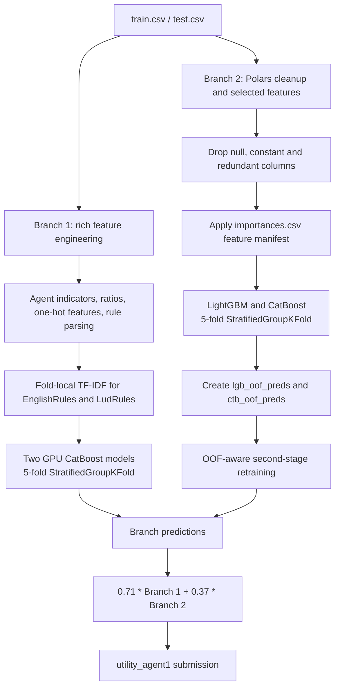

# 🏆 UM - Game-Playing Strength of MCTS Variants

<p align="center">
  <a href="https://www.kaggle.com/competitions/um-game-playing-strength-of-mcts-variants"></a>
  <a href="https://storage.googleapis.com/kaggle-competition-certificates/22972956/0fdb024a3bec2955d8d1962bd629da5f.png"></a>
  
  
  
  
</p>

<p align="center"><b>English</b> | <a href="./README_zh.md">简体中文</a></p>

<div align="center">
  <a href="https://storage.googleapis.com/kaggle-competition-certificates/22972956/0fdb024a3bec2955d8d1962bd629da5f.png">
    
  </a>
  <p><em>🏅 Official Kaggle competition certificate — Bronze Medal, rank 119 of 1,608 teams</em></p>
</div>

## Overview

This repository preserves the Kaggle submission notebook for **UM - Game-Playing Strength of MCTS Variants**. The task is a tabular regression problem: predict `utility_agent1` from game-rule, board, agent, performance, and outcome descriptors. The archived solution combines two deliberately different gradient-boosting branches and uses group-aware validation to reduce leakage across games that share the same ruleset.

### Verified highlights

- **Feature-rich GPU branch:** structured ratios and interactions, agent parsing, rule-text statistics, fold-local TF-IDF, and two CatBoost GPU configurations.
- **Selected-feature CPU branch:** Polars-based cleanup, a feature-selection manifest, LightGBM/CatBoost base models, and OOF-aware second-stage retraining.
- **Leakage-aware validation:** five-fold `StratifiedGroupKFold`, stratified by `round(utility_agent1 * 15)` and grouped by `GameRulesetName`.
- **Final blend:** the notebook combines the two branch predictions as `0.71 * branch_1 + 0.37 * branch_2`.
- **Archived result:** private leaderboard score `0.43045`, Bronze Medal, rank `119 / 1,608`.

The repository intentionally retains the notebook as the primary executable artifact. Generated model files, runtime outputs, and large Kaggle inputs are not committed.

## Solution Architecture



## Technical Approach

### 1. Validation strategy

Both branches use five folds of `StratifiedGroupKFold`:

- `GameRulesetName` is the group key, preventing related rows from being distributed across folds without control.
- `round(utility_agent1 * 15)` is used as the stratification proxy for the continuous target.
- Branch 2 stores fold-level out-of-fold predictions and feeds them into its second-stage models.
- `GroupKFold` is imported in the notebook but is not the splitter used by the final path.

This is the validation design implemented by the notebook; the archive does not include a separate leakage-audit report or a full CV-to-leaderboard experiment ledger.

### 2. Data preprocessing and feature engineering

**Branch 1 (`model_1.Preprocessor.FE`)**

- Creates signed indicators for enumerated MCTS agent configurations.
- Adds board-area, playout/move, efficiency, duration, complexity, timeout, outcome, and action-ratio interactions.
- Clips `PlayoutsPerSecond` to `[0, 25,000]` and `MovesPerSecond` to `[0, 1,000,000]`.
- Decomposes `agent1` and `agent2` into `selection`, `exploration_const`, `playout`, and `score_bounds` components.
- Applies selected one-hot features, removes unstable or redundant columns, and downcasts numeric data for memory efficiency.
- Cleans `EnglishRules` and `LudRules`, adds text-length features, and fits `TfidfVectorizer(max_features=500, ngram_range=(2, 3))` inside each model/fold.

**Branch 2 (`model_2.FE`)**

- Reads the CSVs with Polars using `batch_size=65536`.
- Removes `Id`, raw rule text, training-only win/draw/loss counts, all-null columns, and constant columns.
- Casts `GameRulesetName`, `agent1`, and `agent2` to strings and reduces numeric columns to compact types where possible.
- Applies `/kaggle/input/mcts-gbdt-select-200-features/importances.csv` as a drop-feature manifest.

### 3. Model design and training configuration

| Branch | Model | Full-run configuration preserved in the notebook |
| --- | --- | --- |
| 1 | CatBoost GPU `cat1` | 3,096 iterations, `learning_rate=0.08`, `depth=12`, `l2_leaf_reg=1.25`, `min_data_in_leaf=24` |
| 1 | CatBoost GPU `cat2` | Same core settings, with alternate `bagging_temperature`, `random_strength`, and `max_bin=2048` |
| 2 | LightGBM CPU | 20,000 iterations, `learning_rate=0.07`, `num_leaves=64`, `max_depth=24`, `extra_trees=True`, early stopping 500 |
| 2 | CatBoost CPU | 20,000 trees, `learning_rate=0.03`, `depth=8`, `reg_lambda=0.8`, early stopping 500 |

The notebook evaluates folds with RMSE and uses early stopping where configured. It does not define a custom neural loss, neural-network head, AMP block, EMA, pseudo-labeling stage, or differentiable stacking layer.

### 4. Ensembling and post-processing

- Branch 1 averages predictions from two CatBoost configurations across five folds.
- Branch 1 scales predictions by `1.1` and clips them to `[-0.985, 0.985]`.
- Branch 2 creates base LightGBM/CatBoost OOF predictions, appends them as `lgb_oof_preds` and `ctb_oof_preds`, and retrains OOF-aware models.
- Branch 2 averages fold predictions and applies raw branch weights `0.80` for LightGBM and `0.30` for CatBoost.
- The final submission uses the notebook's exact raw coefficients: `0.71` for Branch 1 and `0.37` for Branch 2. They are not renormalized in the archived code.

### 5. Experiment record boundary

The submitted notebook preserves the final modeling path, but not a complete public experiment ledger. Therefore, the following are documented as open analysis items rather than reported as completed results:

- Separate contribution of rule-text TF-IDF versus structured features.
- Grouped versus ungrouped CV under a leakage audit.
- Branch-level RMSE and final-blend RMSE in one comparable table.
- Normalized versus raw final blend coefficients.

## Results and Evidence

The archived evidence records a **private leaderboard score of `0.43045`**, Bronze Medal, and rank **119 / 1,608**. The notebook's printed `0.43169` is a separate local diagnostic and is not presented as the final leaderboard record.

| Evidence item | Record |
| --- | --- |
| Award | Bronze Medal |
| Final rank | 119 / 1,608 teams |
| Private leaderboard score | `0.43045` |
| Local notebook diagnostic | `0.43169`, not the final leaderboard record |
| Official certificate | `evidence/goldmoreandmore-official-certificate.png` |

Because the archived notebook does not contain a complete, comparable ablation table, unpublished baseline and intermediate scores are not inferred here.

## Repository Structure

```text
.
├── assets/
│   └── certificate.png                         # README hero certificate image
├── evidence/
│   ├── certificate_goldmoreandmore.json        # Certificate API response
│   ├── certificate_goldmoreandmore.metadata.json
│   ├── competition.json                        # Competition metadata
│   ├── goldmoreandmore-official-certificate.png
│   ├── goldmoreandmore-official-certificate-2026-10-14-YU-JIAQI.png
│   │                                             # Historical certificate snapshot
│   ├── goldmoreandmore-official-certificate-2026-10-27-Jiang-Huajian.png
│   │                                             # Current certificate snapshot
│   ├── links.md                                # Official Kaggle links
│   └── team_119.json                            # Rank-119 team record
├── submission/
│   └── mcts-oof-predfe-pubnb-blending-lb-4xx-v4.ipynb
│                                                  # Downloaded Kaggle notebook
├── README.md                                    # English documentation
└── README_zh.md                                 # Simplified Chinese documentation
```

## Environment and Reproducibility

### Runtime

- Notebook metadata declares Python 3.10.14 and a GPU runtime.
- Branch 1 requests CatBoost GPU; Branch 2 explicitly uses CPU LightGBM/CatBoost.
- Local smoke mode uses `APP.small_iterations=True` and `APP.short_dataset=True`.
- Setting `KAGGLE_IS_COMPETITION_RERUN` switches to the full-iteration and full-dataset path.
- Exact GPU model, VRAM, wall-clock time, and peak memory were not preserved in the submitted notebook metadata.

### Installation and inputs

The repository has no standalone `requirements.txt`; the canonical execution environment is Kaggle. The notebook imports:

```text
polars pandas numpy scikit-learn lightgbm catboost xgboost dill
matplotlib plotly kaggle_evaluation
```

The relevant Kaggle inputs are:

```text
/kaggle/input/um-game-playing-strength-of-mcts-variants/train.csv
/kaggle/input/um-game-playing-strength-of-mcts-variants/test.csv
/kaggle/input/um-game-playing-strength-of-mcts-variants/sample_submission.csv
/kaggle/input/mcts-gbdt-select-200-features/importances.csv
```

### Training and inference entry points

The archive is a single notebook rather than a package with shell entry points. The main execution path is:

```python
# Switch off local smoke settings for a full rerun.
APP.small_iterations = False
APP.short_dataset = False

# Branch 1: train five-fold CatBoost models and average fold predictions.
model_1.preprocessor.train_model()

# Branch 2: train base models, add OOF features, then retrain OOF-aware models.
model_2.train_model()

# Generate the final utility_agent1 prediction.
result = predict(test, submission)
```

For an official Kaggle rerun, the notebook registers `kaggle_evaluation.mcts_inference_server.MCTSInferenceServer(predict)` and uses `serve()`; local execution uses `run_local_gateway()`.

The archive depends on Kaggle-mounted CSVs, the auxiliary feature-selection file, GPU CatBoost support for Branch 1, and the official MCTS inference gateway. Generated `.model`, `.npy`, and runtime output files are intentionally excluded.

## Official Links

- [Competition](https://www.kaggle.com/competitions/um-game-playing-strength-of-mcts-variants)
- [Kaggle notebook, script version 208056582](https://www.kaggle.com/code/goldmoreandmore/mcts-oof-predfe-pubnb-blending-lb-4xx?scriptVersionId=208056582)
- [Official certificate page](https://www.kaggle.com/certification/competitions/goldmoreandmore/um-game-playing-strength-of-mcts-variants)
- [Official certificate image](https://storage.googleapis.com/kaggle-competition-certificates/22972956/0fdb024a3bec2955d8d1962bd629da5f.png)
