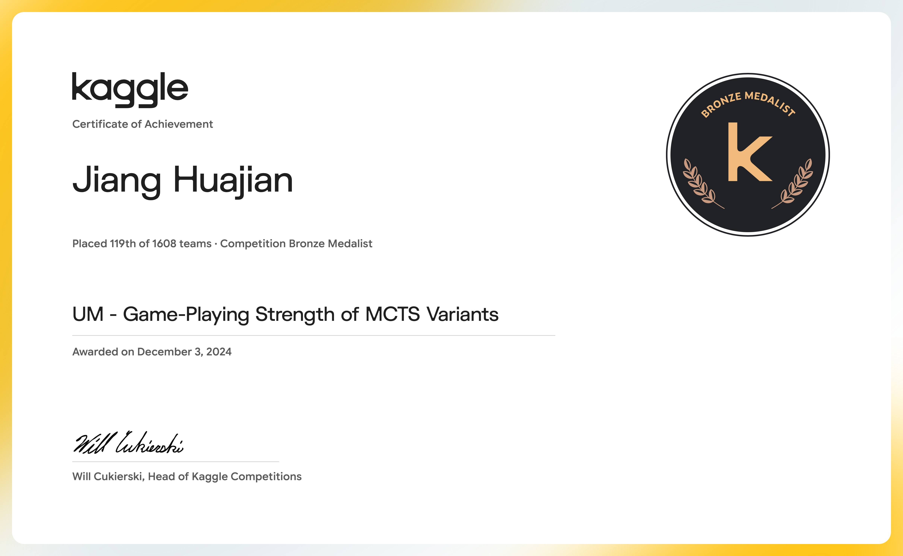
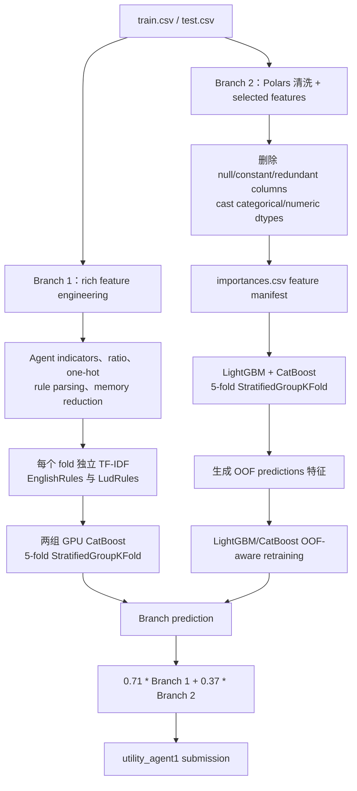

# 🏆 UM - Game-Playing Strength of MCTS Variants — Bronze Medal，119/1,608

<p align="center">
  <a href="https://img.shields.io/badge/Kaggle-Competition-20BEFF?logo=kaggle&logoColor=white&style=flat-square"></a>
  <a href="https://img.shields.io/badge/Award-Bronze%20%7C%20119%2F1608-CD7F32?style=flat-square"></a>
  <a href="https://img.shields.io/badge/Metric-RMSE-555555?style=flat-square"></a>
  <a href="https://img.shields.io/badge/Python-3.10-3776AB?logo=python&logoColor=white&style=flat-square"></a>
  <a href="https://img.shields.io/badge/Stack-CatBoost%20%7C%20LightGBM-2E8B57?style=flat-square"></a>
  <a href="https://img.shields.io/badge/License-Not%20specified-lightgrey?style=flat-square"></a>
</p>

<p align="center"><a href="./README.md">English</a> | <b>简体中文</b></p>

<div align="center">
  <a href="https://storage.googleapis.com/kaggle-competition-certificates/22972956/0fdb024a3bec2955d8d1962bd629da5f.png">
    
  </a>
  <p><em>🏅 Kaggle 官方竞赛奖状：Bronze Medal，1,608 支队伍中排名第 119</em></p>
</div>

## 1. 方案核心摘要

本仓库保存 **UM - Game-Playing Strength of MCTS Variants** 的 Kaggle 提交 Notebook。该方案是一个针对 `utility_agent1` 的 two-branch tabular regression system：第一分支使用 rich feature engineering 与 GPU CatBoost；第二分支使用 selected features、CPU LightGBM/CatBoost 和 OOF-aware retraining。两个分支都使用以 `GameRulesetName` 为 group 的 `StratifiedGroupKFold`，最终按照 Notebook 中的固定系数进行融合。

归档 Notebook 保留 source cells 与 runtime metadata；为保持仓库可审阅并避免保存临时日志/图表，已清理生成的 cell outputs。

### 赛题与核心挑战

- **任务：** 根据游戏规则、棋盘、agent、性能和结果描述预测连续目标 `utility_agent1`。
- **Metric：** Notebook 使用 RMSE 做 fold evaluation 和本地诊断。
- **泛化风险：** 相同 `GameRulesetName` 的数据不应在 CV 中被不当拆散，否则会造成 group leakage 风险。
- **特征异质性：** 同时包含数值统计、agent categorical configuration、长规则文本、稀疏 one-hot 列和高维元数据。

### 核心方案

Branch 1 构造 agent 与游戏结构特征、比例和交互特征，清洗 `EnglishRules`/`LudRules`，再用五折 `StratifiedGroupKFold` 训练两个 GPU CatBoost。Branch 2 删除空列、常量列和冗余列，应用 `importances.csv` 的 feature-selection manifest，训练五折 LightGBM/CatBoost；随后把两类 base model 的 OOF prediction 作为新特征，重新训练 OOF-aware models。最终预测为 `0.71 * branch_1 + 0.37 * branch_2`。

## 2. 整体架构与流水线



### 流水线阶段

1. **Input 与 runtime mode：** 使用 Polars/Pandas 读取 Kaggle CSV；`KAGGLE_IS_COMPETITION_RERUN` 会关闭本地短跑设置。
2. **Branch 1 preprocessing：** 构造 agent-position indicators、棋盘面积和效率比例，进行 outlier clipping，拆分 agent 字符串，增加选定 one-hot 特征，解析 `LudRules`，删除不稳定/冗余列并做 memory downcast。
3. **Branch 1 text features：** 清洗规则文本、增加长度特征，并在每个 model/fold 内拟合 `TfidfVectorizer(max_features=500, ngram_range=(2, 3))`。
4. **Branch 2 preprocessing：** 删除 Id、全空列、常量列、显式冗余列与 `importances.csv` 指定的 drop features；保留 categorical 类型。
5. **Training 与 inference：** 两个分支都对 `round(utility_agent1 * 15)` 做 stratification，并以 `GameRulesetName` 做 group，然后平均各 fold prediction 再进入 final blend。

## 3. 核心技术细节

### 3.1 Validation Strategy

代码实际使用 `StratifiedGroupKFold`，group 是 `GameRulesetName`，stratification proxy 是 `round(y * 15)`：

- **Branch 1：** 实际创建 `Preprocessor(num_folds=5, ...)`，因此是五折；构造函数默认十折没有被最终调用使用。
- **Branch 2：** `CFG.n_splits = 5`，也是五折。
- **OOF integrity：** Branch 2 保存 fold OOF predictions，将其写入 `lgb_oof_preds` 和 `ctb_oof_preds`，再训练第二阶段 OOF-aware models。
- `GroupKFold` 虽然被 import，但最终路径并未使用它。

### 3.2 数据预处理与特征工程

**Branch 1（`model_1.Preprocessor.FE`）：**

- 为枚举的 MCTS agent configuration 构造 signed indicators；
- 增加 area、playout/move、efficiency、duration、complexity、timeout、outcome 和 action-ratio 交互；
- 将 `PlayoutsPerSecond` clip 到 `[0, 25,000]`，将 `MovesPerSecond` clip 到 `[0, 1,000,000]`；
- 将 `agent1`/`agent2` 拆成 `selection`、`exploration_const`、`playout`、`score_bounds`；
- 对低基数数值/agent 字段做 one-hot；
- 移除 `LudRules` 的 game-name 前缀，提取 player/rule 信息，并删除大量不稳定或冗余列；
- 对数值列做 memory reduction；
- 清洗 `EnglishRules` 与 `LudRules`，增加文本长度并生成 fold-local TF-IDF。

**Branch 2（`model_2.FE`）：**

- 通过 Polars 以 `batch_size=65536` 读取数据；
- 删除 `Id`、原始规则文本、训练集专有 win/draw/loss counts、全空列和单值列；
- 将 `GameRulesetName`、`agent1`、`agent2` 转为 string，将数值列尽可能转为 `Int16` 或 `Float32`；
- 应用 `/kaggle/input/mcts-gbdt-select-200-features/importances.csv` 的 drop-feature manifest。

### 3.3 Model 与训练配置

| Branch | Model | Full submission mode 中的关键参数 |
| --- | --- | --- |
| 1 | CatBoost GPU `cat1` | 3,096 iterations，`learning_rate=0.08`、`depth=12`、`l2_leaf_reg=1.25`、`min_data_in_leaf=24`、`bagging_temperature=0.50`、`random_strength=0.25` |
| 1 | CatBoost GPU `cat2` | 核心配置相同，`bagging_temperature=0.60`、`random_strength=0.20`、`max_bin=2048` |
| 2 | LightGBM CPU | 20,000 iterations，`learning_rate=0.07`、`num_leaves=64`、`max_depth=24`、`extra_trees=True`、`reg_alpha=0.1`、`reg_lambda=0.8`、early stop 500 |
| 2 | CatBoost CPU | 20,000 trees，`learning_rate=0.03`、`depth=8`、`reg_lambda=0.8`、early stop 500 |

Notebook 使用 RMSE evaluation 和 early stopping；没有自定义 Loss、神经网络 Head、AMP、EMA、pseudo-labeling 或 differentiable stacking layer。

### 3.4 Ensembling 与 Post-processing

- Branch 1 对两个 CatBoost 配置的五折 prediction 求平均。
- Branch 1 将 prediction 乘以 `1.1` 后 clip 到 `[-0.985, 0.985]`。
- Branch 2 先生成 base LightGBM/CatBoost OOF prediction，写入新特征，再训练 OOF-aware models。
- Branch 2 inference 对 fold prediction 求平均，并使用 LightGBM `0.80`、CatBoost `0.30` 的 raw branch weights。
- 最终 submission 使用代码中的 `0.71` 与 `0.37`，Notebook 没有对这两个系数重新归一化，因此文档保留原始系数。

### 3.5 未采用方案与待补实验

- `[TODO]` 对比 grouped CV 与 ungrouped CV，并补充 leakage audit。
- `[TODO]` 单独量化 rule-text TF-IDF 相对于 structured features 的增益。
- `[TODO]` 在同一 experiment ledger 中记录两个 branch 和 final blend 的 RMSE。
- `[TODO]` 对比 normalized 与 raw final blend coefficients。

## 4. 验证与消融结果

归档证据记录的 team result 为 **private score 0.43045、rank 119/1,608**。Notebook 打印的 `0.43169` 是独立的 local/notebook diagnostic，不应与最终 team leaderboard record 混淆。

| Stage / Experiment | Key Changes | Local CV | Public LB | Private LB |
| :--- | :--- | :---: | :---: | :---: |
| Baseline | Raw tabular model + grouped RMSE validation | `[TODO]` | `[TODO]` | `[TODO]` |
| Branch 1 | Rich structural features + fold-local TF-IDF + GPU CatBoost | `[TODO]` | `[TODO]` | `[TODO]` |
| Branch 2 | Selected features + LightGBM/CatBoost OOF-aware retraining | `[TODO]` | `[TODO]` | `[TODO]` |
| Final submission | `0.71 * Branch 1 + 0.37 * Branch 2` | `[TODO]` | `[TODO]` | `0.43045（归档 team record）` |

## 5. 工程目录结构

```text
.
├── assets/
│   └── certificate.png                         # README Hero 证书图片
├── evidence/
│   ├── certificate_goldmoreandmore.json        # 当前 API certificate response
│   ├── certificate_goldmoreandmore.metadata.json
│   ├── competition.json                        # 比赛元数据
│   ├── goldmoreandmore-official-certificate.png
│   ├── goldmoreandmore-official-certificate-2026-10-14-YU-JIAQI.png
│   │                                             # 历史证书快照
│   ├── goldmoreandmore-official-certificate-2026-10-27-Jiang-Huajian.png
│   │                                             # 当前证书快照
│   ├── links.md                                # 官方 Kaggle links
│   └── team_119.json                            # 第 119 名 team record
├── submission/
│   └── mcts-oof-predfe-pubnb-blending-lb-4xx-v4.ipynb
│                                                  # 下载的 Kaggle Notebook
├── README.md                                    # 英文技术文档
└── README_zh.md                                 # 简体中文技术文档
```

## 6. 环境与复现

### 6.1 硬件与运行时

- Notebook metadata 声明 GPU runtime 与 Python 3.10.14。
- Branch 1 使用 CatBoost GPU；Branch 2 明确使用 CPU LightGBM/CatBoost。
- 本地 smoke mode 使用 `APP.small_iterations=True` 与 `APP.short_dataset=True`。
- 设置 `KAGGLE_IS_COMPETITION_RERUN` 后，代码切换到 full iterations 与 full dataset。
- `[TODO: 补充实际 GPU 型号、显存、完整运行时间和峰值内存]`。

### 6.2 安装

仓库没有独立 `requirements.txt`。Notebook 实际 import：

```text
polars pandas numpy scikit-learn lightgbm catboost xgboost dill
matplotlib plotly kaggle_evaluation
```

规范运行环境是 Kaggle Notebook，并挂载以下 input：

```text
/kaggle/input/um-game-playing-strength-of-mcts-variants/train.csv
/kaggle/input/um-game-playing-strength-of-mcts-variants/test.csv
/kaggle/input/um-game-playing-strength-of-mcts-variants/sample_submission.csv
/kaggle/input/mcts-gbdt-select-200-features/importances.csv
```

### 6.3 Training 与 Inference 入口

该归档是单个 Notebook，不是带 shell entry point 的 Python package。真实执行路径为：

```python
# Local smoke mode 默认开启；正式 Kaggle rerun 时切换为 False。
APP.small_iterations = False
APP.short_dataset = False

# Branch 1：第一次 predict 时训练，并平均保存的 fold models。
model_1.preprocessor.train_model()

# Branch 2：训练 base LightGBM/CatBoost，增加 OOF features，
# 再训练 OOF-aware LightGBM/CatBoost。
model_2.train_model()

# Notebook 的最终 prediction path。
result = predict(test, submission)
```

正式执行时，Notebook 注册 `kaggle_evaluation.mcts_inference_server.MCTSInferenceServer(predict)`；competition rerun 使用 `serve()`，否则使用 `run_local_gateway()`。

### 6.4 复现边界

该 Notebook 依赖 Kaggle CSV、辅助 feature-selection 文件、Branch 1 的 GPU CatBoost 和官方 MCTS inference gateway。仓库有意排除生成的 `.model`、`.npy` 与 runtime output。

## 官方链接

- [Competition](https://www.kaggle.com/competitions/um-game-playing-strength-of-mcts-variants)
- [Kaggle Notebook，script version 208056582](https://www.kaggle.com/code/goldmoreandmore/mcts-oof-predfe-pubnb-blending-lb-4xx?scriptVersionId=208056582)
- [Official certificate page](https://www.kaggle.com/certification/competitions/goldmoreandmore/um-game-playing-strength-of-mcts-variants)
- [Official certificate image](https://storage.googleapis.com/kaggle-competition-certificates/22972956/0fdb024a3bec2955d8d1962bd629da5f.png)
