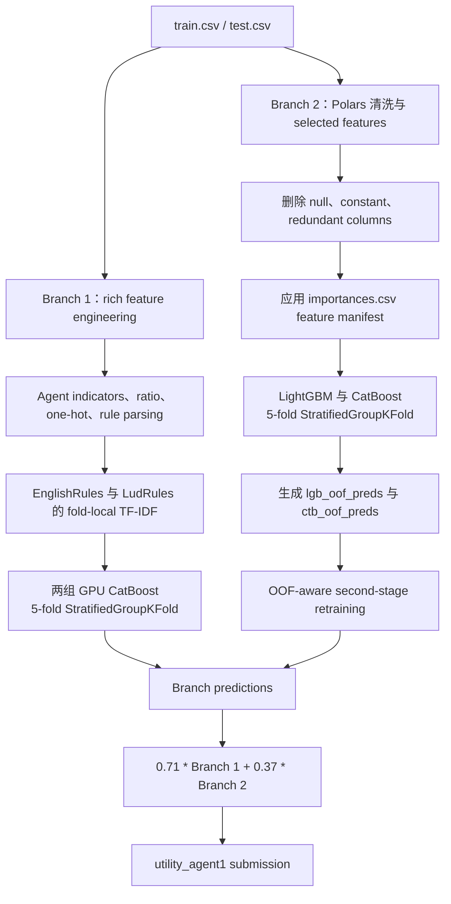

# 🏆 UM - Game-Playing Strength of MCTS Variants

<p align="center">
  <a href="https://www.kaggle.com/competitions/um-game-playing-strength-of-mcts-variants"></a>
  <a href="https://storage.googleapis.com/kaggle-competition-certificates/22972956/0fdb024a3bec2955d8d1962bd629da5f.png"></a>
  
  
  
  
</p>

<p align="center"><a href="./README.md">English</a> | <b>简体中文</b></p>

<div align="center">
  <a href="https://storage.googleapis.com/kaggle-competition-certificates/22972956/0fdb024a3bec2955d8d1962bd629da5f.png">
    
  </a>
  <p><em>🏅 Kaggle 官方竞赛证书：Bronze Medal，1,608 支队伍中排名第 119</em></p>
</div>

## 项目概览

本仓库归档 **UM - Game-Playing Strength of MCTS Variants** 的 Kaggle 提交 Notebook。任务是一个 tabular regression 问题：根据游戏规则、棋盘、agent、性能和结果描述，预测目标 `utility_agent1`。最终方案由两个具有互补特征视角的 gradient-boosting 分支组成，并通过 group-aware validation 降低相同 ruleset 之间的数据泄漏风险。

### 已核实亮点

- **Feature-rich GPU branch：** 构造结构化 ratio 与 interaction、解析 agent、提取 rule-text statistics、使用 fold-local TF-IDF，并训练两组 CatBoost GPU 配置。
- **Selected-feature CPU branch：** 使用 Polars 清洗数据、应用 feature-selection manifest，训练 LightGBM/CatBoost base models，并进行 OOF-aware second-stage retraining。
- **Leakage-aware validation：** 五折 `StratifiedGroupKFold`，以 `round(utility_agent1 * 15)` 做 stratification，以 `GameRulesetName` 做 grouping。
- **Final blend：** 按 Notebook 中的实际代码使用 `0.71 * branch_1 + 0.37 * branch_2`。
- **归档结果：** private leaderboard score `0.43045`，Bronze Medal，排名 `119 / 1,608`。

仓库保留 Notebook 作为主要可执行资产；生成的模型文件、运行时输出和大型 Kaggle 输入数据没有提交到仓库。

## 整体架构



## 技术方案

### 1. Validation strategy

两个分支都使用五折 `StratifiedGroupKFold`：

- `GameRulesetName` 作为 group key，避免同一 ruleset 相关样本在 folds 之间被无控制地拆散。
- `round(utility_agent1 * 15)` 作为连续目标的 stratification proxy。
- Branch 2 保存 fold-level out-of-fold predictions，并将其作为第二阶段模型的输入特征。
- Notebook 虽然 import 了 `GroupKFold`，但最终执行路径使用的不是它。

以上是 Notebook 中真正实现的 validation design；仓库没有额外保存独立的 leakage-audit report 或完整的 CV-to-leaderboard experiment ledger。

### 2. Data preprocessing and feature engineering

**Branch 1（`model_1.Preprocessor.FE`）**

- 为枚举的 MCTS agent configuration 构造 signed indicators。
- 增加 board-area、playout/move、efficiency、duration、complexity、timeout、outcome 和 action-ratio interactions。
- 将 `PlayoutsPerSecond` clip 到 `[0, 25,000]`，将 `MovesPerSecond` clip 到 `[0, 1,000,000]`。
- 将 `agent1` 与 `agent2` 拆分为 `selection`、`exploration_const`、`playout` 和 `score_bounds` 组件。
- 对选定字段做 one-hot，删除不稳定或冗余列，并对数值数据进行 memory downcast。
- 清洗 `EnglishRules` 与 `LudRules`，增加 text-length features，并在每个 model/fold 内拟合 `TfidfVectorizer(max_features=500, ngram_range=(2, 3))`。

**Branch 2（`model_2.FE`）**

- 使用 Polars 读取 CSV，`batch_size=65536`。
- 删除 `Id`、原始规则文本、训练集专有的 win/draw/loss counts、全空列和常量列。
- 将 `GameRulesetName`、`agent1`、`agent2` 转为 string，并尽可能将数值列转换为紧凑类型。
- 应用 `/kaggle/input/mcts-gbdt-select-200-features/importances.csv` 作为 drop-feature manifest。

### 3. Model design and training configuration

| Branch | Model | Notebook 中保留的 full-run 配置 |
| --- | --- | --- |
| 1 | CatBoost GPU `cat1` | 3,096 iterations，`learning_rate=0.08`、`depth=12`、`l2_leaf_reg=1.25`、`min_data_in_leaf=24` |
| 1 | CatBoost GPU `cat2` | 核心参数相同，使用不同的 `bagging_temperature`、`random_strength`，并设置 `max_bin=2048` |
| 2 | LightGBM CPU | 20,000 iterations，`learning_rate=0.07`、`num_leaves=64`、`max_depth=24`、`extra_trees=True`、early stopping 500 |
| 2 | CatBoost CPU | 20,000 trees，`learning_rate=0.03`、`depth=8`、`reg_lambda=0.8`、early stopping 500 |

Notebook 使用 RMSE 做 fold evaluation，并在配置中使用 early stopping。代码没有定义 custom neural loss、neural-network head、AMP、EMA、pseudo-labeling 或 differentiable stacking layer。

### 4. Ensembling and post-processing

- Branch 1 对两组 CatBoost 配置的五折 predictions 求平均。
- Branch 1 将 prediction 乘以 `1.1`，再 clip 到 `[-0.985, 0.985]`。
- Branch 2 先生成 LightGBM/CatBoost base OOF predictions，写入 `lgb_oof_preds` 和 `ctb_oof_preds`，再训练 OOF-aware models。
- Branch 2 对各 fold prediction 求平均，并使用 LightGBM `0.80`、CatBoost `0.30` 的 raw branch weights。
- Final submission 使用 Notebook 中的原始系数：Branch 1 为 `0.71`，Branch 2 为 `0.37`；归档代码没有重新归一化这两个系数。

### 5. Experiment record boundary

提交 Notebook 保存了最终建模路径，但没有保存完整的公开实验 ledger。因此下面这些内容只作为后续分析边界，不被包装成已经完成的实验结果：

- rule-text TF-IDF 相对于 structured features 的独立贡献；
- grouped CV 与 ungrouped CV 在 leakage audit 下的对比；
- branch-level RMSE 与 final-blend RMSE 的统一记录；
- normalized 与 raw final blend coefficients 的对比。

## 结果与证据

归档证据记录：**private leaderboard score `0.43045`**、Bronze Medal，最终排名 **119 / 1,608**。Notebook 打印的 `0.43169` 是独立的 local diagnostic，不作为最终 leaderboard record。

| 证据项 | 记录 |
| --- | --- |
| Award | Bronze Medal |
| Final rank | 119 / 1,608 teams |
| Private leaderboard score | `0.43045` |
| Local notebook diagnostic | `0.43169`，不是最终 leaderboard record |
| Official certificate | `evidence/goldmoreandmore-official-certificate.png` |

由于归档 Notebook 没有完整、可比的 ablation table，未保存的 baseline 与中间实验分数不在此处推断。

## 工程目录

```text
.
├── assets/
│   └── certificate.png                         # README Hero 证书图片
├── evidence/
│   ├── certificate_goldmoreandmore.json        # Certificate API response
│   ├── certificate_goldmoreandmore.metadata.json
│   ├── competition.json                        # 比赛元数据
│   ├── goldmoreandmore-official-certificate.png
│   ├── goldmoreandmore-official-certificate-2026-10-14-YU-JIAQI.png
│   │                                             # 历史证书快照
│   ├── goldmoreandmore-official-certificate-2026-10-27-Jiang-Huajian.png
│   │                                             # 当前证书快照
│   ├── links.md                                # 官方 Kaggle 链接
│   └── team_119.json                            # 第 119 名 team record
├── submission/
│   └── mcts-oof-predfe-pubnb-blending-lb-4xx-v4.ipynb
│                                                  # 下载的 Kaggle Notebook
├── README.md                                    # English 技术文档
└── README_zh.md                                 # 简体中文技术文档
```

## 环境与复现

### Runtime

- Notebook metadata 声明 Python 3.10.14 与 GPU runtime。
- Branch 1 请求 CatBoost GPU；Branch 2 明确使用 CPU LightGBM/CatBoost。
- Local smoke mode 使用 `APP.small_iterations=True` 与 `APP.short_dataset=True`。
- 设置 `KAGGLE_IS_COMPETITION_RERUN` 后，代码切换到 full-iteration 与 full-dataset 路径。
- 提交 Notebook metadata 没有保留确切 GPU 型号、显存、运行时长和峰值内存。

### 安装与输入

仓库没有独立的 `requirements.txt`；规范执行环境是 Kaggle。Notebook 实际 import：

```text
polars pandas numpy scikit-learn lightgbm catboost xgboost dill
matplotlib plotly kaggle_evaluation
```

相关 Kaggle inputs：

```text
/kaggle/input/um-game-playing-strength-of-mcts-variants/train.csv
/kaggle/input/um-game-playing-strength-of-mcts-variants/test.csv
/kaggle/input/um-game-playing-strength-of-mcts-variants/sample_submission.csv
/kaggle/input/mcts-gbdt-select-200-features/importances.csv
```

### Training 与 inference 入口

该归档是单个 Notebook，而不是带 shell entry points 的 Python package。主要执行路径为：

```python
# 完整 rerun 时关闭 local smoke settings。
APP.small_iterations = False
APP.short_dataset = False

# Branch 1：训练五折 CatBoost，并平均各 fold prediction。
model_1.preprocessor.train_model()

# Branch 2：训练 base models，加入 OOF features，再训练 OOF-aware models。
model_2.train_model()

# 生成最终 utility_agent1 prediction。
result = predict(test, submission)
```

正式 Kaggle rerun 时，Notebook 注册 `kaggle_evaluation.mcts_inference_server.MCTSInferenceServer(predict)` 并使用 `serve()`；本地运行使用 `run_local_gateway()`。

该归档依赖 Kaggle-mounted CSV、辅助 feature-selection 文件、Branch 1 所需的 GPU CatBoost，以及官方 MCTS inference gateway。生成的 `.model`、`.npy` 和 runtime output 文件被有意排除。

## 官方链接

- [Competition](https://www.kaggle.com/competitions/um-game-playing-strength-of-mcts-variants)
- [Kaggle Notebook，script version 208056582](https://www.kaggle.com/code/goldmoreandmore/mcts-oof-predfe-pubnb-blending-lb-4xx?scriptVersionId=208056582)
- [Official certificate page](https://www.kaggle.com/certification/competitions/goldmoreandmore/um-game-playing-strength-of-mcts-variants)
- [Official certificate image](https://storage.googleapis.com/kaggle-competition-certificates/22972956/0fdb024a3bec2955d8d1962bd629da5f.png)
